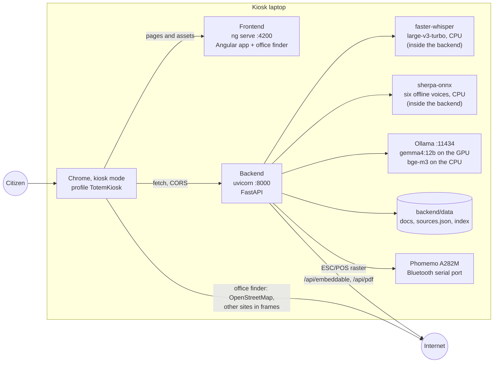
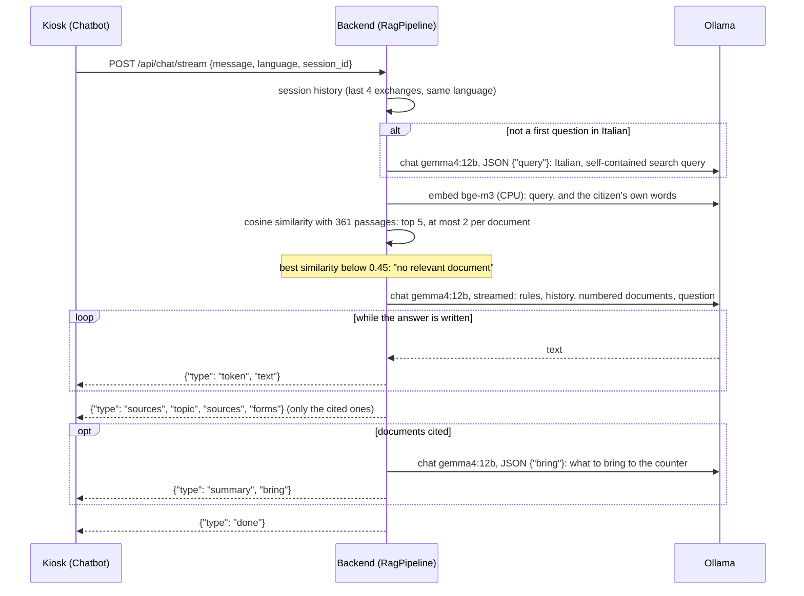
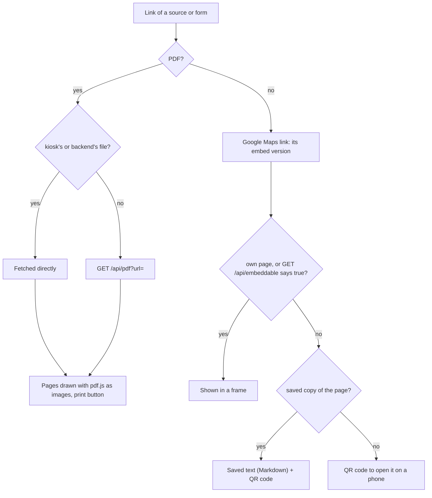
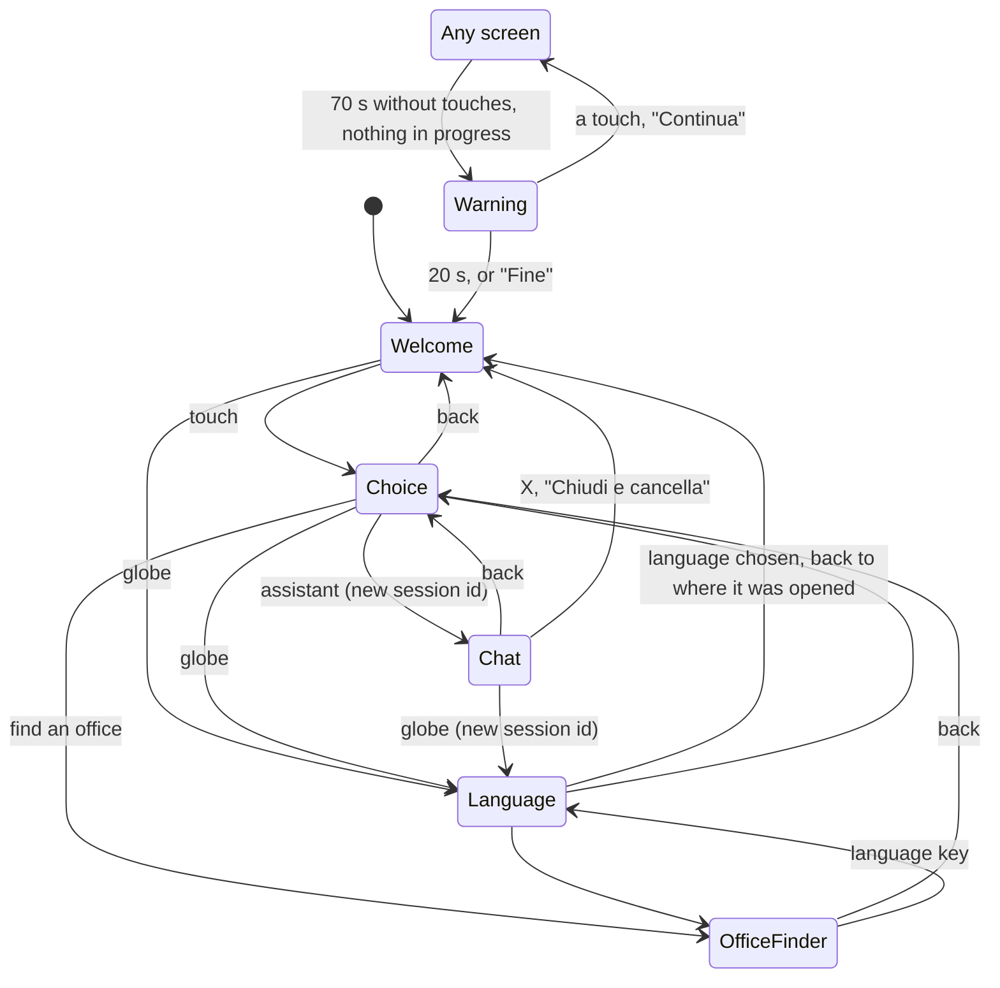

# Architecture and API

How the parts of the kiosk fit together, what each request does, and the contract of every endpoint of the backend.

## Overview

| Process | Port | Started by | Logs |
| --- | --- | --- | --- |
| Ollama | 11434 | Windows at login, or `kiosk/avvia-totem.ps1` | Ollama's own |
| Backend: `uv run uvicorn app.main:app --port 8000` | 8000 | `kiosk/avvia-totem.ps1` | window "Totem - backend" |
| Frontend: `npm start` (`ng serve`) | 4200 | `kiosk/avvia-totem.ps1` | window "Totem - frontend" |
| Chrome `--kiosk --user-data-dir=%LOCALAPPDATA%\TotemKiosk` | | `kiosk/avvia-totem.ps1` | |

The frontend and the backend are two servers on two ports: the browser calls the backend directly at `http://localhost:8000` ([`frontend/src/app/api.config.ts`](../frontend/src/app/api.config.ts)), and the backend allows the origin of the frontend (`TOTEM_CORS_ORIGINS`). The office finder (`frontend/public/webapp/`) is served by the frontend's server, so it is the same origin as the kiosk: the kiosk can listen to its text fields and its touches, and the two talk with `postMessage`.

## Answering a question

- The prompts are in English, which small models follow best ([`backend/app/prompts.py`](../backend/app/prompts.py)); the documents stay in Italian and the answer is in the citizen's language, with the Italian names of offices and documents kept.
- `AnswerCleaner` ([`backend/app/rag.py`](../backend/app/rag.py)) drops from the stream what the kiosk would show as raw text: Markdown bold and bracketed notes that are not citations.
- The citations `[n]` select the sources returned; the forms are those of the cited documents (`forms` in `sources.json`), or the cited document itself when it is a form.
- The subject of the answer (`topic`) is that of its first cited document in `sources.json`: `cie`, `residenza`, `stranieri`, `certificati`, `autocertificazione`, `estero` or `stato-civile`; `null` when the answer cites nothing, as for a greeting. The kiosk groups the conversation by subject with it.
- What to bring comes from a second, short call on the finished answer (`temperature` 0, a JSON schema): at most six items in the citizen's language, with the Italian names in parentheses ([`backend/app/summary.py`](../backend/app/summary.py)). It adds about a second; if it fails, the answer stays without the list.

## Dictation and reading aloud

- **Dictation.** The kiosk records the microphone with `MediaRecorder` (WebM/Opus) until 1.5 s of silence after speech, 7 s without speech, or 30 s, then posts the recording to `/api/transcribe?language=xx`. The backend decodes it with PyAV to 16 kHz mono and transcribes it with Whisper in the kiosk's language (beam 5, voice activity filter). The recording is never saved. About 5 s for a 5 s question on the reference kiosk.
- **Reading aloud.** The kiosk cuts the answer into lines and sentences and posts each one to `/api/tts` with the kiosk's language; the backend drops the source numbers and list dashes, synthesises the sentence with the offline voice of the language (sherpa-onnx: Piper voices, Meta MMS for Bengali and Filipino) and returns a WAV. The kiosk plays the sentences in order and asks for the next one while the current one plays: about 0.1 s per sentence with the Piper voices, 0.7 s with the MMS ones. Pause and resume work on the sentence playing; the text is not logged. The kiosk shows the reading keys only in the languages listed by `/api/tts/languages`, those whose voice is loaded. The backend keeps the last 200 sentences read for 10 minutes, so reading an answer again is immediate.

## Opening links

The kiosk has no tabs: sources, forms and the links of the office finder open in the link viewer, next to the chat or over the office finder.

## Printing

The print key of the summary panel, of the chat (in windows narrower than 1200 px, which have no panel) and of a form's viewer opens the same dialog ([`frontend/src/app/print.service.ts`](../frontend/src/app/print.service.ts)), with the documents of the conversation grouped by subject:

- **The summary for the counter** of each subject, ticked: the subject, what to bring, then the questions and answers about it, drawn on A4 canvases ([`frontend/src/app/conversation-doc.ts`](../frontend/src/app/conversation-doc.ts)). For a conversation not in Italian, the kiosk first sends the messages to `/api/conversation/translate` and draws two columns, the original on the left and the Italian on the right; an Italian conversation has one column. Without subjects, there is one summary of the whole conversation.
- **The forms** of each subject, drawn with pdf.js: ticked when the citizen opened them, when they are the only form of the subject, or when the print started from their viewer.

The citizen unticks what they do not need, can look at each document full size, page by page, and confirms the number of sheets. The pages go as PNG data URLs to `/api/print/stream`. The backend scales each page to an A4 sheet within 0.5 cm margins, turns it into black and white (threshold 170) and sends it as ESC/POS raster commands to the serial port of the printer, found by its Bluetooth address ([`backend/app/printer.py`](../backend/app/printer.py)); after each sheet it sends an event, and the dialog shows "foglio 2 di 5". If the printer stops, the dialog says at which sheet, and "Riprova" prints again from there. A backend without the stream (404 or 405) gets the whole job at `/api/print`, without progress. One job at a time.

## Session lifecycle

Going back to the welcome screen by the chat's red X (after "Vuoi chiudere e cancellare la conversazione?") or by the warning ends the session ([`frontend/src/app/session.service.ts`](../frontend/src/app/session.service.ts)): dictation and reading stop, the print dialog and the link viewer close, the accessibility choices are reset, the language, the conversation and the forms opened are forgotten, and the next citizen gets a new session id. The backend's memory of the old session is no longer reachable and expires after 10 minutes. The 70 s timer waits while an answer, a transcription, a reading or a print is in progress.

## API reference

Base URL `http://localhost:8000`. Errors are FastAPI's `{"detail": "..."}` with the status shown. Request bodies are JSON unless stated otherwise.

### `POST /api/chat/stream`

The answer to a question, as newline-delimited JSON (`application/x-ndjson`).

| Field | Type | |
| --- | --- | --- |
| `message` | string, 1-2000 characters | The citizen's question |
| `language` | `it`, `uk`, `zh`, `bn`, `tl`, `ar` | Language of the answer; anything else, or none, means Italian |
| `session_id` | string, up to 100 characters, optional | Conversation memory; a new id starts a new conversation |

Events, in order: any number of `{"type": "token", "text": "..."}`, then `{"type": "sources", "topic": "cie", "sources": [...], "forms": [...]}`, then, when the answer cites documents and mentions something to bring, `{"type": "summary", "bring": ["...", ...]}`, then `{"type": "done"}`. `topic` is that of the first cited source, `null` when nothing is cited. A failure after the response has started arrives as a last `{"type": "error", "message": "..."}`.

- source: `{"number": 1, "title": "...", "kind": "pagina" | "modulo" | "norma" | "guida", "url": "original page, or the file", "copy": "http://localhost:8000/files/... or null", "topic": "cie"}`
- form: `{"id": "modulo-richiesta-cie", "title": "...", "url": "http://localhost:8000/files/modulo-richiesta-cie.pdf", "topic": "cie"}`

### `POST /api/chat`

Same body; the whole answer at once: `{"reply": "...", "topic": "cie", "sources": [...], "forms": [...], "bring": [...]}`. 502 if Ollama fails.

### `POST /api/transcribe?language=xx`

The body is the recording itself (WebM/Opus from Chrome, or WAV, OGG...), at most 10 MB; `language` is the kiosk's language, given to Whisper. Response `{"text": "..."}`, empty when nothing was said. 422 if the recording is empty or cannot be decoded, 413 if it is too long.

### `POST /api/tts`

`{"text": "...", "language": "bn"}`: one sentence of an answer, 1-1000 characters. Response: the sentence read aloud by the voice of the language (anything else than the six languages means Italian), as `audio/wav`, 16-bit mono. 204 when nothing is left to read once the citations are dropped (`"[1][3]"`), 422 if the text is empty or too long or reading aloud is turned off (`TOTEM_TTS_ENABLED=false`), 502 if the voice fails or is missing.

### `GET /api/tts/languages`

`{"languages": ["it", "uk", "zh", "bn", "tl", "ar"]}`: the languages whose voice is loaded, waiting for the voices to load if needed; `[]` with `TOTEM_TTS_ENABLED=false`. The kiosk hides the reading keys in the other languages.

### `POST /api/conversation/translate`

`{"language": "uk", "texts": ["...", "..."]}`, 1-60 messages. Response `{"texts": [...]}`: the same messages in Italian, in the same order, with the source numbers kept. An Italian conversation comes back unchanged. 502 if a translation fails.

### `POST /api/print`

`{"pages": ["data:image/png;base64,...", ...]}`, 1-50 pages, one per A4 sheet. Response `{"printed": true}` when the pages have been sent. 422 if a page is not valid base64, 503 if the printer cannot be reached.

### `POST /api/print/stream`

Same body; the response is newline-delimited JSON, one event per sheet: `{"type": "prepared", "total": 3}` once the pages are accepted, `{"type": "page", "page": 1, "total": 3}` after each sheet has gone to the printer, `{"type": "done", "total": 3}` at the end. If the printer cannot be reached or stops, the last event is `{"type": "error", "message": "...", "page": 2}`, with the sheet where the print stopped. 422 if a page is not valid base64. The print goes on even if the kiosk stops reading the events.

### `GET /api/embeddable?url=...`

`{"embeddable": true}` when the page at `url` answers and neither `X-Frame-Options` nor a `frame-ancestors` directive forbids showing it in a frame. Results are cached for 6 hours.

### `GET /api/pdf?url=...`

The PDF at `url` (http or https only, at most 30 MB), downloaded by the backend for the kiosk's PDF viewer. 502 if it cannot be downloaded or is not a PDF.

### `GET /files/{file}`

A file of `backend/data/docs/`: forms and the saved copies of the pages.

### `GET /api/health`

`{"status": "ok", "llm_model": "gemma4:12b", "embed_model": "bge-m3", "passages": 361, "voices_loaded": true}`. `passages` is 0 when the index has not been built; `voices_loaded` is false until all six voices are in memory, or when one is missing (`uv run python -m app.voices`).

## Data

| Path | Content | In git |
| --- | --- | --- |
| `backend/data/sources.json` | The documents: id, title, kind, topic, original URL, file, linked forms | yes |
| `backend/data/docs/` | The documents' files: pages saved as Markdown, official PDF forms | yes |
| `backend/data/index/` | `documents.json`, `chunks.jsonl` (passages of at most 1200 characters, split by headings), `vectors.npy` (bge-m3, normalised), `meta.json` | no: `uv run python -m app.ingest` |
| `backend/models/tts/` | The six voices that read the answers: ONNX models, their tokens and espeak-ng data, 490 MB | no: `uv run python -m app.voices` |
| `backend/data/demo_questions.json` | Questions for `app.compare` | yes |
| `frontend/src/assets/translation.json` | Texts of the kiosk screens, per language | yes |
| `frontend/public/webapp/dati/sedi-precaricate.js` | Offices of Rome and Verona for the office finder | yes, regenerated by `aggiorna-dati.mjs` |

## Design choices

- **Everything local.** The citizens' questions, voices and answers do not leave the laptop: Ollama for the models, faster-whisper for dictation, sherpa-onnx voices for reading aloud. The browser's own voices were dropped: on Windows, Chrome has none for Ukrainian, Bengali, Filipino and Arabic, and its Chinese one is online.
- **Embeddings only.** A BM25 keyword search was tried alongside the embeddings and dropped: on 31 labelled questions it made the retrieval worse.
- **Embeddings on the CPU.** The VRAM is left to the language model: its answers start 2-3 times sooner.
- **Two servers.** The kiosk runs the Angular development server and the backend separately, as during development; the start script hides the difference.
- **Out of Windows' efficiency mode.** The backend runs in a minimized window, behind the kiosk's browser: Windows 11 would run it on the efficient cores only, and dictation took 34 s instead of 5 ([`backend/app/power.py`](../backend/app/power.py)).
